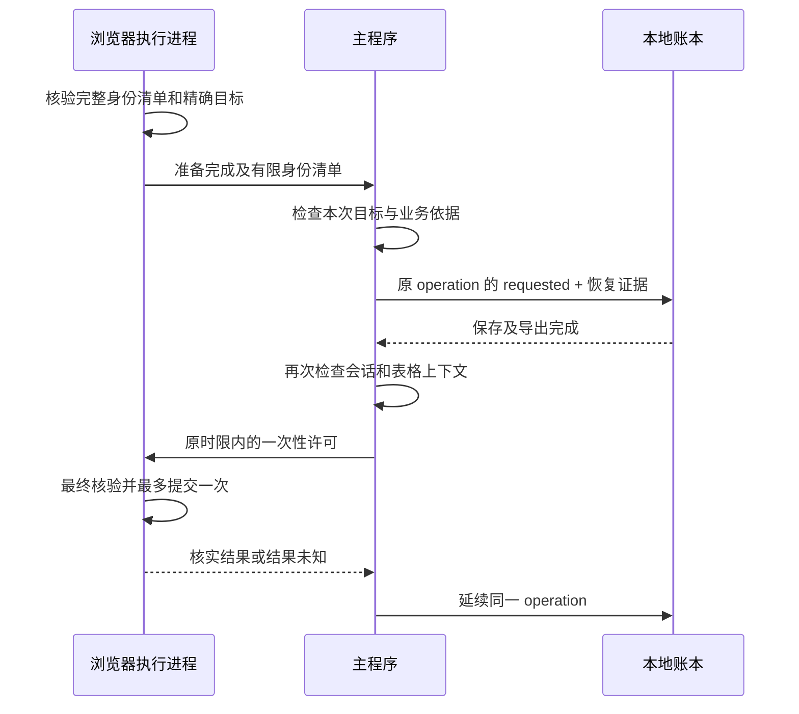

# 2026-11-06 恢复证据、多 Key 调度与预测记录改造

开发版本：`0.2.0a2.dev0`，尚未发布。

本轮从已发布 AI 版的本地 Git 基线 `5d267c714af000ed9288488676ab25f09e2380d8` 建立独立开发副本。原发布源码、旧包、真实账本及其他未提交改动保留。没有访问真实账户、调用付费 API、撤销真实 Key、提交或推送。

本记录沿用“实际改动、改动理由、已经运行的验证、仍未解决或未验证的事项”四项。输入依据是两份 2026-11-05 多 Key 调度评审及其交叉核对结果；评审建议不自动成为真实测试或改变业务规则的授权。

## 一、实际改动

### 1. 先保存原操作的恢复证据，再签发许可

原先只保存人员绑定时，未填写到人员表中的 Harness 或普通对照身份可能在重启后丢失。即使原目标已经消失，也可能因为缺少独立对照而无法安全确认。

现在浏览器完成准备阶段的 HTTP 和网页身份核验后，将完整身份清单交给主程序。主程序验证其属于本次精确目标，把下列有限字段写入原操作的 `requested` 事件，保存成功后才签发一次性许可：

| 字段 | 内容与作用 |
| --- | --- |
| `schema` | 整数版本 `1` |
| `account_id` | 当前账本已有的账户连续性标识；不是新增的官方稳定账户 ID |
| `target_tracking_id` | 本次精确目标的完整 Tracking ID |
| `known_tracking_ids` | 准备阶段核验过的完整身份集合，包含目标和至少一枚独立对照 |
| `source` | 固定来源 `prepared_http_inventory_v1` |

证据不保存姓名、完整密钥、授权头、Cookie、请求原文或响应原文。IDs 不作为授权凭证使用；该集合与业务额度依据仍是本地账本数据。

- 准备完成与批准删除是两件事。合法清单不会自动生成许可，IPC 也不延长许可时限。
- 许可绑定的目标只读；清单一旦安装不能换成另一套身份。字段多余、缺失、重复、过大、凭证形态或与当前目标不一致时拒绝。
- SQLite 中 `requested` 与恢复证据一同提交；导出失败时不批准，已提交的原证据继续保留用于核实。
- 后续观察和同账户继承账本沿用原操作证据；禁止在已经可能提交以后用新观察补造旧依据。
- 重启后的只读核实重新取得原目标及对照集合的本机互斥。未填入人员表的原对照也包含在内。
- 旧操作缺少该证据时保持兼容核实路径，不声称已经补全，也不因此自动重试删除。

### 2. 多 Key 候选队列进入原自动管理循环

增加 `CandidateQueue`，输入是原业务函数已经认定可以处理的候选行。队列负责先后顺序，不另写额度规则、身份判定或删除许可。

- 一个完整评估批次内的新候选共享同一确认时间，以完整 Tracking ID 区分，排除对 Excel 行号、页面顺序和名称排序的依赖。
- 当前生产接入没有可靠速率，按确认批次和稳定身份选择；相同范围内刷新完整费用不会清空连续等待年龄。
- 停止、管理代际改变、账本或业务上下文改变会重置队列；不把单调时钟持久化并跨进程复用。
- 等待过期费用重新读取时保留本次年龄；若返回的新费用不完整，正额度目标失去资格并离队，恢复完整证据后重新确认。没有把所有读取失败都解释为“继续保留全部候选”。
- 一个窗口同一时刻仅处理一个目标。完成并保存其结果后，立即安排下一目标核验，不额外等待整个轮询间隔。
- 下一项仍通过原来的费用新鲜度、工作簿、精确身份、本机互斥和未决操作检查；过期先刷新，未知结果停止。
- UI 显示候选数量和最长等待时间。切换账本时清除旧队列和预测提示。

队列模块保留“可靠当前目标速率 + 等待老化”的确定性排序能力与测试。默认老化阈值为 30 秒，表示排序权重，不是处理期限或服务承诺。**本轮没有将预测速率接入实际优先级。**

### 3. 预测先做独立记录

有效费用应用完成后，单独写入 `forecast-shadow.sqlite3`。主账本仍是额度与操作责任的依据；预测记录失败只产生有限诊断，不回滚已成功应用的费用，也不制造删除候选。

隔离范围包含账本、账期、基线、规则、工作簿和完整人员绑定历史；标识经散列后保存。数据仍包含金额、时间和预测状态，散列不等于匿名或加密，不应随公开 Issues 上传。

- 同目标、同内容及同覆盖信息复读只更新最后读取时间，保留第一次观察时间，不伪造新的消费时间点。
- 整份响应的散列发生变化，不自动代表本目标有新消费样本。
- 纯预测模块区分完整/不完整、时间未知、低分辨率日桶、零额度、旧样本重放、累计下降、历史修订、上下文切换和过期等状态。
- 只有具备可信覆盖时间、稳定修订信息和足够连续有效差分时，才具备计算估计速率及 ETA 的基础。当前接入未传入适配器尚不能确认的时间证据，故保持未知，不输出可执行 ETA。
- 每个目标上下文最多保留 12 条，整个数据库最多 2048 条；写入等待超时有限，数据库启用自动回收空闲页面。数量限制不等于精确字节承诺，短暂事务文件或损坏文件仍须单独处理。
- 不上传到本地模型、不训练模型、不增加云端请求。现有本地 AI 诊断权限不变。

### 4. 业务规则保持

| 原规则 | 本轮处理 |
| --- | --- |
| 空姓名、`-1` 跳过 | 保留，不进入费用管理候选或预测记录 |
| `0` 为零额度 | 保留现有零额度资格和身份核验 |
| 正额度到线 | 保留既有金额完整性和阈值判断，不按未知费用删除 |
| 公共额度及历史绑定费用 | 保留原核算方式 |
| 全自动管理 | 保留；一次启动后无需逐枚人工审批 |
| 强制删除 | 保留独立入口；免额度条件，不免精确身份和未决责任核验 |
| 停止/中断 | 不签发新许可；已批准或可能提交的操作保持核实责任 |
| 原操作结果未知 | 继续阻止新删除，不把重启或“仍存在”当成安全重试许可 |
| Harness/未知类型 | 可以承担已核验身份对照，不因此变成普通可删除目标 |

### 5. 主要代码位置

| 文件 | 责任 |
| --- | --- |
| `quota_guard/recovery_evidence.py` | 有界恢复证据结构及精确目标验证 |
| `quota_guard/core.py` | 同操作持久化、继承及恢复读取；完整绑定范围读取 |
| `quota_guard/revocation_permit.py` | 准备清单不可变传递，保留原一次性时限许可 |
| `quota_guard/browser_service.py` | 实际准备核验成功后提供身份清单 |
| `quota_guard/browser_process.py` | IPC 传递和重复校验，异常中止 |
| `quota_guard/scheduler.py` | 已合格候选的公平排序和年龄维护 |
| `quota_guard/forecast_shadow.py` | 单独、有限的观察记录与纯预测状态计算 |
| `quota_guard/ui.py` | 接入授权、恢复互斥、串行推进及状态显示 |

### 6. 回归暴露的既有诊断排序缺陷

两条日志在 Windows 同一个时钟刻度写入时，时间戳可能相同。旧读取器只按时间戳排序，较早的费用事件会排在较新的删除准备事件之前，让本地 AI 助手首先展示错误的案例。

`quota_guard/diagnostics.py` 现以文件内明确的追加顺序处理时间戳相同的记录；跨时间戳仍沿用原排序。冻结时钟稳定复现后修复，并保留原来“模型只接收单事件六个固定字段”的严格断言。此修复改变展示排序，没有扩大模型可读取内容或操作权限。

## 二、改动理由

1. **原操作恢复必须依靠原证据。** 只保留活动人员绑定无法覆盖未受管对照；用下一次页面快照补造原证据也不能说明原提交时的上下文。应在批准前保存，并与同一操作绑定。
2. **多目标问题主要是调度和责任边界。** 乱序由稳定身份处理，连续候选由等待时间处理，结果未知由原操作状态机处理。没有必要为这一阶段引入多写入进程或让 LLM 决定删除。
3. **消费时间不能用读取时间代替。** 账单复读、历史修订和日桶都可能使差分失真。先收集可信程度和未知原因，再决定将来是否启用速率优先，避免预测反而延后已经到线的处理。
4. **离线验证需要经过真实应用接线。** 单纯队列模拟无法证明 GUI、账本和许可真的保持先保存后提交，因此补充真实 Tk、临时磁盘账本、实际许可与受控假平台的整合检查。
5. **可选预测不能破坏主链。** 它使用独立数据库、有限历史和独立失败处理；原自动管理仍依赖已核验的实际费用。

## 三、已经运行的验证

以下均使用合成身份、临时账本和假平台，不代表真实 DeepSeek 端到端验证。

| 层级 | 验证内容 | 当前结果 |
| --- | --- | --- |
| 恢复存储 | 新证据落盘、跨操作拒绝、修订拒绝、继承账本、文件缺失与保存故障 | 18 项定向通过 |
| 恢复 GUI 工作流 | 未绑定 Harness/普通对照，App 重建后继续原 operation，保存前/导出后故障拒绝许可，恢复互斥覆盖原对照 | 5 项定向通过 |
| 许可与 IPC | 缺证据、错误目标、额外凭证字段、重复/过大清单、不可变目标、迟到消息、真实子进程往返 | 10 项定向通过 |
| 队列模块 | 同时到线、稳定排序、年龄、公平性、速率未知/零、冲突及上下文改变 | 16 项定向通过 |
| 队列应用整合 | 100 枚连续处理、乱序、过期刷新、停止与迟到回调、未知结果及业务分支 | 7 项定向通过 |
| 预测与应用隔离 | 22 项记录/估计检查及 4 项 Tk 整合，失败隔离、伪造预测摘要不改变资格 | 26 项定向通过 |
| 诊断排序 | 固定同时间戳，单事件六字段隔离，最大显示条数裁剪仍保留最新追加行 | 相关 30 项定向通过 |
| 全量离线回归 | 统一发现并运行全部测试 | **1043 项全部通过，347.050 秒，退出码 0** |

100 枚整合测试保留一枚额外的未绑定普通对照，以反序人员表开始，实际走 100 次 UI、SQLite、表格导出、`requested` 保存和一次性许可消费。平台提交和缺席结果是假实现。检查得到 100 个独立操作，清单由 101 缩至 2，只有最初一次管理启动确认。**测试耗时不代表平台吞吐或真实停费时间。**

离线回归也包含原有 Windows 子进程退出与清理检查；其中终止对象为测试自建进程，不是用户应用。恢复工作流新增测试是关闭旧 App 后重新打开，不能冒充真实系统崩溃或断电验证。

首轮统一回归实际运行 946 项，耗时 277.079 秒，退出码 `1`，结果为 1 项失败、11 项错误，**没有通过**。其中 10 项错误由默认 Chromium 路径不存在导致，部分类尚未进入测试；另一个旧测试夹具绕过 App 构造函数，缺少新增队列；唯一断言失败为上述同时间戳日志排序缺陷。随后复用工作区已有的离线 Chromium，补齐夹具，并修复排序。轮询/浏览器会话/请求头的 31 项定向复测通过；诊断相关 30 项定向复测通过。

最终统一回归：Windows、Python 3.12.14、现有离线 Chromium 1248，运行 `python -B -m unittest discover -s tests -q`。仅在测试进程内指定工作区临时目录、已有浏览器运行时及 UTF-8 输出；没有修改系统环境变量或下载新依赖。**1043 项全部通过，347.050 秒，退出码 0**，相对基线 960 项新增 83 项。

`git diff --check` 通过；28 个改动 Python 文件完成 AST 语法检查；30 个改动文件中没有运行账本、浏览器会话或运行数据库。原发布源码工作树仍保持干净，Apache-2.0 许可证、署名及锁定依赖没有改动。最终完整日志保存在本轮开发目录的 `validation/full-regression-final.log`，首轮失败日志保留为 `validation/full-regression.log`。Tk 主题提示仍保留在日志中，最终通过不表示已消除该提示。

## 四、仍未解决或未验证的事项

- **真实测试待用户明确开始。** 本轮没有真实登录、平台删除或付费请求；不能声明已经可投入生产。
- **没有真实统计时间与速率依据。** 预测记录已接入，但实时 ETA 与速率优先尚未启用。未来必须先确认来源时间、历史修订、目标归属和延迟口径。
- **没有并发删除。** 100 枚测试是单窗口串行执行。平台的读取/提交延迟、限速、成功率和最终停费时间未测；30 秒老化不是最大等待保证。
- **队列年龄仅保留在当前管理运行内。** 没有逐候选的长期排队审计、可删除集合/幸存对照数量预计算或动态分批刷新。原逐项最后一枚保护仍执行；没有增加逐批人工审批。
- **滚动预测记录不是完整回测档案。** 未实现实际首次可见到线标签、长期历史版本及预测误差报表。纯函数能处理显式提供的历史修订标记，但尚不能从累计总额自行识别正向回补或互相抵消的旧桶修订。没有新增热点查询或自适应读取频率。
- **互斥仍是当前机器上的 Tracking ID 互斥。** 不是稳定账户级全局队列，也不是跨设备的持久操作登记系统。两个设备同时管理同账户的保证未建立。
- **恢复需要仍可独立确认的对照。** 原对照若全部消失、身份不一致或证据损坏，保持无法确认，不自动推断成功。当前仍有“缺少独立对照时不执行最后一枚删除”的应用保护。
- **旧数据不能自动补证据。** 旧操作未保存过的上下文只能保持原有恢复限制。已有真实账本未迁移或清理。
- **保存失败后的未知责任仍可能需要核实。** SQLite 已提交后发生导出故障时，本轮不授予新许可，但不会把原操作自行改写为“可重新提交”。
- **新恢复证据没有做真实机器强杀/断电耐久验收。** 关闭重开及注入 I/O 故障验证不能替代操作系统或存储设备故障。
- **Windows 新试用包尚未构建，未做干净机器长期运行。** 旧包保持原样；此开发源码的离线通过不回填为旧包通过。
- **正额度真实消费跨线、真实 Excel/WPS 导入、复杂同机操作干扰**仍保留先前未验收标记。
- **基线已有的 Tk 主题事件提示仍存在。** 测试连续销毁窗口时出现 `ThemeChanged / application has been destroyed`，旧版最终通过日志中也有相同提示。本轮没有定位并消除该测试销毁时的提示，不将其与实际测试失败混为一谈。
- **清理记录：** 早期预测测试曾因测试读取连接未关闭而残留 5 个合成临时目录，测试连接已修复并复测。自动审批拒绝清理这些目录，理由为 `blocked by policy`；没有改用其他方式删除。后续测试使用工作区临时目录。该记录不涉及真实账本或浏览器登录资料。

真实联调下一步应先只读核对当前账户、精确目标、独立对照和恢复责任，再由用户明确开始测试。任何结果未知都先核实原操作，不通过反复启动新删除来“碰运气”。
